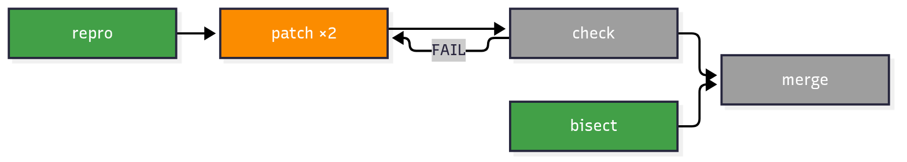
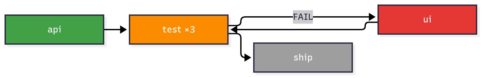

# workgraph

Orchestrate work as a cyclic directed graph of subagent-executed nodes with transition criteria on edges, budgeted cycles, and per-node gates (runtime verification, metric, or artifact). Use when the user says "workgraph", "run this as a graph", "graph this work", or when a goal has parallel branches, feedback loops, or mixed gate types that a linear loop cannot express. Every node is sized to a 64k context budget, so small goals run as a two-node do/verify graph and large goals scale out without caps. For clock-driven or metric-driven single loops, timeboxed-iterating and autoresearch remain lighter.

## Example graphs

Every render uses the skill's fixed palette:
`gray PENDING · blue READY · orange RUNNING · green VERIFIED · red FAILED · purple ESCALATED`

### Two-node do/verify

The smallest graph — a small goal ("add dark mode to a todo app") is one
mutating node and its verify node.


### Branch-and-merge with a feedback loop

Two branches merge at a gate, and a failed check feeds back into the patch
node (`patch ×2` is the visit counter) — e.g. for "fix a flaky test".



### Mid-run state

A snapshot during the loop: `api` verified, `ui` failed after the `test`
gate rejected it, `test ×3` running, `ship` pending.



```bash
npx skills add av/skills --skill workgraph
```

Part of [av/skills](https://github.com/av/skills) — a library of agent skills for Claude Code, Codex, OpenCode and other coding agents.
