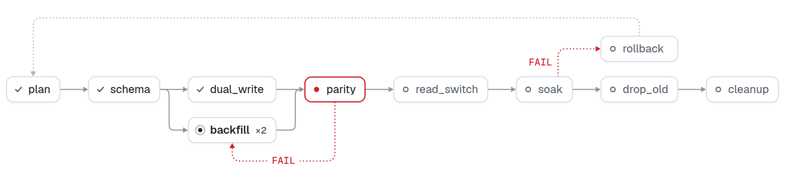
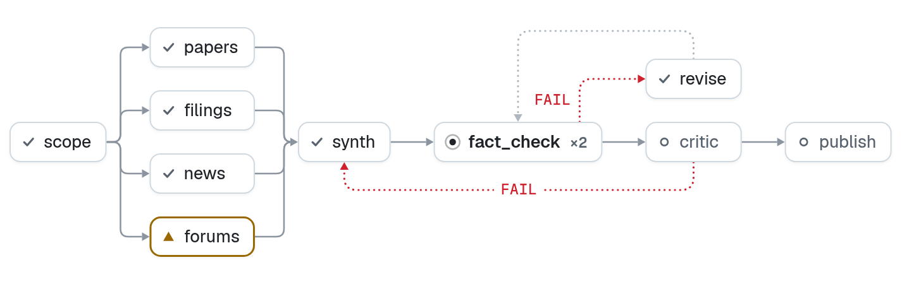
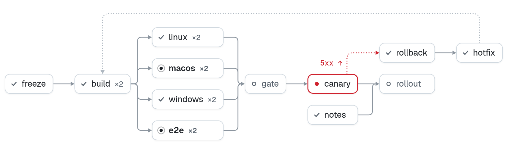

# workgraph

Orchestrate work as a cyclic directed graph of subagent-executed nodes with transition criteria on edges, budgeted cycles, and per-node gates (runtime verification, metric, or artifact). Use when the user says "workgraph", "run this as a graph", "graph this work", or when a goal has parallel branches, feedback loops, or mixed gate types that a linear loop cannot express. Every node is sized to a 64k context budget, so small goals run as a two-node do/verify graph and large goals scale out without caps. For clock-driven or metric-driven single loops, timeboxed-iterating and autoresearch remain lighter.

## Example graphs

Every render uses the skill's fixed palette:
`dashed PENDING · outlined READY · bold RUNNING · gray VERIFIED · red FAILED · amber ESCALATED`

### Database migration with dual-write and a rollback gate

`dual_write` and `backfill` run in parallel and rejoin at the `parity`
gate. Parity found row drift, so the FAIL edge sent `backfill` back for a
second pass (`×2`). A failed `soak` routes to `rollback`, and from there
back to `plan`.

<picture>
  <source media="(prefers-color-scheme: dark)" srcset="./assets/graph-db-migration-dark.png">
  
</picture>

<picture>
  <source media="(prefers-color-scheme: dark)" srcset="./assets/graph-legend-dark.png">
  
</picture>

### Multi-source research report with fact-check and revision

`scope` fans out to four source nodes that rejoin at `synth`. `forums`
escalated (the source was unreachable) and the report went ahead without
it. `fact_check` rejected the first draft, `revise` fixed it, and the
second check is running now. A `critic` FAIL goes back to `synth`.

<picture>
  <source media="(prefers-color-scheme: dark)" srcset="./assets/graph-research-report-dark.png">
  
</picture>

### Release with a test matrix, canary and rollback

`build` fans out to a four-way test matrix behind a single `gate`. The
first canary tripped on a 5xx spike, so `rollback` and `hotfix` ran and
the graph looped back into `build`. Second visits (`×2`) are in progress
on macOS and e2e, while `notes` waits at `rollout`.

<picture>
  <source media="(prefers-color-scheme: dark)" srcset="./assets/graph-release-canary-dark.png">
  
</picture>

```bash
npx skills add av/skills --skill workgraph
```

Part of [av/skills](https://github.com/av/skills) — a library of agent skills for Claude Code, Codex, OpenCode and other coding agents.
